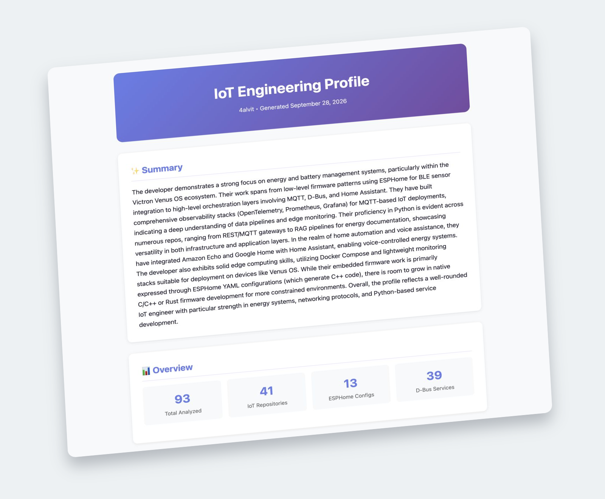

# IoT Project Builder

[](docs/images/iot-profile-report.jpg)

*Actual HTML output from the public profile dated 28 September 2026.
Counts and assessments are historical generated output, not a current project inventory.
[Original screenshot and regeneration](docs/images/README.md).*

[](docs/fuzzing.md)

Generate an engineering profile from public GitHub repositories. The scanner
collects repository metadata and IoT signals; analyzers inspect ESPHome and
D-Bus patterns; the renderer produces Markdown, HTML, JSON and charts.

The [published profile](https://4alvit.github.io/iot-project-builder-profile/)
is a dated scan, not a release-readiness report or a complete inventory. The
[maintained project directory](https://github.com/4alvit/4alvit) is the entry point
for current public projects and their own installation instructions.

## Generate a profile

Requires Python 3.11 or newer and [uv](https://docs.astral.sh/uv/).
From a clean checkout:

```sh
uv sync --locked --all-extras
uv run --locked iot-profile-builder 4alvit \
  --orgs victron-venus,ha-homelab,open-ott-play \
  --max-repos 100 --no-llm --output ./profile
```

Without a token, GitHub's unauthenticated rate limit applies. For an authorized
scan, pass `--token` from a credential supplied by your environment or CI secret
store; never put a literal token in a committed command or shell history. Public
repository scanning does not require account-wide write access.

The CLI defaults to those three organizations when `--orgs` is omitted. It
filters repositories marked private before content analysis and excludes forks
by default. The IoT relevance threshold also excludes some public projects, so
absence from a generated profile is not evidence that a project is missing or
inactive. Review scan errors and the generation date before using the results.

`--no-llm` selects heuristic analysis. To enable optional language-model analysis,
configure `ANTHROPIC_API_KEY`, optionally `ANTHROPIC_BASE_URL` for your authorized
compatible endpoint, and choose a supported `--model`. Remove `--no-llm` only
when that service is configured. The profile generator sends its analysis
context to the configured service; use the heuristic mode when that is unwanted.

## Outputs and ownership

For username `4alvit`, the output directory contains `4alvit_profile.md`,
`4alvit_profile.html`, `4alvit_profile.json` and chart assets. Generated files
belong under `profile/`; GitHub Pages copies them into `docs/` and installs the
HTML entry point as `docs/index.html`.

The HTML profile is self-contained: charts, styling and repository filtering do
not require external scripts, fonts or network requests. Source records use native
expandable sections, and repository links, scores and analysis remain readable
without JavaScript. The presentation is maintained in
`iot_profile_builder/output/profile_page.py`, so scheduled regeneration keeps
the same design. A visual refresh does not change the snapshot date or scores.

Only the output directory needs to be writable. Standard templates are loaded
from memory; `ProfileRenderer(template_dir=...)` reads any supplied overrides
and uses the standard template for each missing file without creating it there.

This README is maintained documentation. The generator does not rewrite its
project links or provide live CI, deployment or hardware-acceptance status.
Repository counts, scores and language summaries belong in dated generated
outputs rather than fixed badges or hand-maintained status tables.

## Find the right project

- **[Victron / Venus OS](https://github.com/victron-venus)** covers D-Bus bridges,
  battery/PV/grid telemetry, control, dashboards and reusable CI. Its
  [organization guide](https://github.com/victron-venus/.github) explains project
  roles. Newer entries include [vehicle telemetry](https://github.com/victron-venus/dbus-ev),
  [Emporia submetering](https://github.com/victron-venus/dbus-emporia-vue) and
  [energy-aware climate control](https://github.com/victron-venus/inverter-climate).
- **[HA Homelab](https://github.com/ha-homelab)** publishes the
  [DESLOC integration](https://github.com/ha-homelab/ha-desloc) and
  [card](https://github.com/ha-homelab/ha-desloc-card),
  [Echo Dot 2](https://github.com/ha-homelab/ha-echo-dot) and
  [Echo Show 5 Gen2](https://github.com/ha-homelab/ha-echo-show-5) conversion guides,
  and [SLZB-06 recovery](https://github.com/ha-homelab/slzb-06-recovery).
- **[Open OTT Play](https://github.com/open-ott-play)** separates the
  [FOSS player](https://github.com/open-ott-play/ottplay-foss),
  [native Android app](https://github.com/open-ott-play/ottplay-android),
  [shared core and FOSS2](https://github.com/open-ott-play/ottplay-core),
  [control server](https://github.com/open-ott-play/ottplay-control-server),
  [text-entry Worker](https://github.com/open-ott-play/ottplay-swop) and
  [hosted publication](https://github.com/open-ott-play/ottplay-web-vitrine).
- Personal reusable tools include
  [MCP for Venus OS](https://github.com/4alvit/mcp-venus-os),
  [energy-document retrieval](https://github.com/4alvit/energy-data-rag-pipeline),
  [solar forecasting](https://github.com/4alvit/solar-forecast-langgraph),
  [MQTT observability](https://github.com/4alvit/mqtt-observability-opentelemetry),
  [REST/MQTT bridging](https://github.com/4alvit/fastapi-mqtt-gateway),
  [D-Bus templates](https://github.com/4alvit/dbus-service-template) and
  [ESPHome BLE patterns](https://github.com/4alvit/esphome-ble-sensor-patterns).
- The energy-report adapters for
  [Amazon Echo](https://github.com/4alvit/amazon-echo-home-voice) and
  [Google Home / Nest](https://github.com/4alvit/google-home-voice-stats) consume
  [Inverter Gateway](https://github.com/victron-venus/inverter-gateway).

Follow each repository's setup and safety instructions. This directory does not
prescribe a combined deployment or establish compatibility between arbitrary
versions. Archived projects remain references and should not be presented as
active installation targets.

## Automated profile updates

The refresh runs every Monday at **06:00 UTC**, and can also be started manually
from **Actions → Update IoT Developer Profile → Run workflow** on `main`.
Scheduled runs collect public GitHub evidence and generate the narrative with
the explicitly configured language model. A failed scan or model request stops
publication. GitHub may delay scheduled jobs.

Runner routing follows `CI_RUNNER_MODE`: `github` (the default) selects a hosted
Linux runner; `self-hosted` or its `k3s` alias selects the configured
`CI_RUNNER_AUTOMATION_LABELS` pool. This supports ARC scale sets, using their
registered scale-set name or configured alias instead of static `self-hosted`
and `fcc` labels. A configured variable alone is not proof that an ARC pool is
registered for this repository. No runner-mode change is made by the workflow.

Each run scans into a fresh temporary directory with `--strict-scan`. Before
publication, `scripts/stage_profile.py` rejects failed, empty, mismatched or stale
output, then copies only the selected user's HTML, Markdown and JSON into
`profile/` and `docs/`, plus the exact HTML into `docs/index.html`. Optional PNG
exports stay outside the publication tree. A validated snapshot is retained as
a seven-day Actions artifact for diagnosis.

The workflow scans public repositories using `GITHUB_TOKEN` and creates a
reviewable update through `scripts/publish_profile.py`. Publication
uses `BOT_PAT` to create a GitHub-signed commit containing only generated profile
files and the Pages entry point, including deletions. It verifies the signature
and complete tree. If the base or target branch advances, publication stops;
regenerate from the current default branch before retrying.

Required CI and signed-commit rules still apply. The publisher does not make an
unreviewed profile into a release or change another project's deployment.

Model generation requires an explicit `ANTHROPIC_BASE_URL` secret, a
`PROFILE_LLM_MODEL` Actions variable and the endpoint's credentials. A protected
Cloudflare Access route uses the paired `PROFILE_ACCESS_CLIENT_ID` and
`PROFILE_ACCESS_CLIENT_SECRET` secrets; a direct compatible endpoint can use
`ANTHROPIC_API_KEY`. The endpoint must be reachable from the selected runner.
There is no embedded gateway or credential fallback. Disabling `use-llm` on a
manual run explicitly selects a heuristic refresh. See the [profile refresh runbook](docs/profile-refresh.md)
for recovery, ARC checks and verification of the published date.

## Development

```sh
bash scripts/ci.sh lint
bash scripts/ci.sh test
```

The scanner, analyzers, generator and renderer live in `iot_profile_builder/`.
Tests use the repository's configured test-readiness check. For security checks
and required tools, see the operator runbook below.

<!-- ci-release-process:start -->
## Release process

See the [release strategy](RELEASING.md) for validation, nightly, beta, RC and stable promotion rules, and the [operator runbook](docs/release-workflow.md) for local commands.
<!-- ci-release-process:end -->

## License

[MIT](LICENSE). Linked projects have their own licenses and contribution policies.

## Contributing and security

See [CONTRIBUTING.md](CONTRIBUTING.md) for development, bug reports and proposals,
[SECURITY.md](SECURITY.md) for confidential vulnerability reports and deployment
boundaries, and the [OpenSSF evidence index](docs/openssf-evidence.md) for assessment
scope and verification.

TLS client requirements and supported proxy behavior are documented in
[the TLS policy](docs/tls-policy.md).

## Release-candidate fuzzing

The actual D-Bus source analyzer receives synthetic Python/XML-like text in memory. Repeated analysis must produce the same typed service/interface/path result. It does not scan files, fetch GitHub data or execute submitted source text.

[RC-only fuzzing policy, local reproduction and failure handling](docs/fuzzing.md).

Release artifact identity, build receipts and local reproduction are documented in
[release packaging](docs/release-packaging.md).

## Maintenance and supported profiles

See the [complete heuristic and TLS profile](docs/SUPPORTED_PROFILE.md), [governance](GOVERNANCE.md), [Code of Conduct](CODE_OF_CONDUCT.md), and [one-year roadmap](ROADMAP.md). The public OpenSSF questionnaire records evidence and remaining limitations.

[](https://www.bestpractices.dev/projects/15569)
