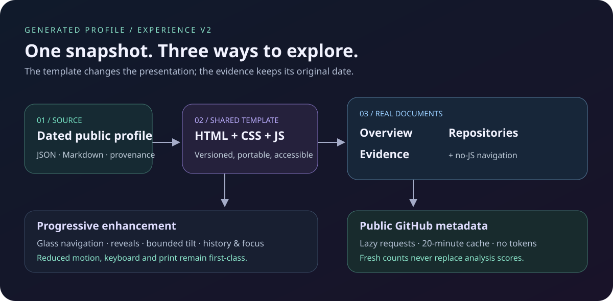

# Profile experience template

Every generated profile uses the same HTML, CSS and JavaScript template. The
presentation survives scheduled regeneration; maintain the source template instead
of editing `docs/index.html` by hand. All pages remain usable as ordinary documents.



## What the reader gets

- A floating glass navigation bar and a layered hero illustrating the analysis
  pipeline with real snapshot counts.
- Gentle scroll reveals and pointer-driven card tilt. The motion button pauses
  decoration, and the operating system's reduced-motion preference takes priority.
- An overview, a searchable repository view, and an evidence view. Normal links
  work without JavaScript. On the hosted site, internal navigation replaces the
  main content, keeps the navigation bar, and updates the title, focus and history.
- Optional fresh stars, forks and repository update dates from GitHub's public API.
  These are labelled separately from the original analysis date and scores.

The hero illustrates how the profile was assembled. Its cards are not live device
telemetry, a deployment inventory, or evidence of current service health.

## Source ownership

`iot_profile_builder/output/profile_page.py` owns the layout, inline SVG and CSS.
`profile_behavior.py` owns progressive enhancement. `renderer.py` supplies the
dated profile, page kind and a Content Security Policy hash for the trusted script.
The browser does not execute scripts from fetched documents.

The built-in renderer produces these files for one username:

```text
<username>_profile.html   Complete overview, including all source evidence
repositories.html       Focused repository catalogue
evidence.html           Focused analysis and evidence
<username>_profile.json  Original machine-readable snapshot
<username>_profile.md    Original readable report
```

Keep one profile per output directory: the two focused views intentionally use
fixed filenames. `scripts/stage_profile.py` validates the complete version-2 set
before copying anything. Each HTML main element must identify the same username,
generation timestamp and template version, with the correct page kind. Publication
copies the five files into both `profile/` and `docs/`, plus the overview into
`docs/index.html`: eleven explicitly allowed paths. Legacy output retains its
three-file, seven-target publication contract.

## Preview and change the template

Generate a fresh profile using the README commands, or reconstruct an existing
published JSON snapshot with `profile_from_dict` from the renderer module and pass
it to `ProfileRenderer`. Reconstruction preserves the date, scores and provenance;
it does not contact GitHub or the configured language model. Missing private source
configuration is not invented from the public report.

For local navigation testing, serve the generated directory over HTTP:

```sh
python -m http.server 8000 --bind 127.0.0.1 --directory docs
```

Open `http://127.0.0.1:8000/`. A downloaded HTML file also displays the full report,
but `file:` mode leaves navigation to the browser and does not automatically fetch
live metadata. It needs the neighbouring HTML pages for the focused-view links.

Keep the main-element version and data attributes consistent across the three
views. Change the protocol version if future markup becomes incompatible with
the existing client controller. Preserve meaningful headings, real link targets,
visible focus outlines and default-visible content. Add motion only as enhancement;
do not make access to evidence depend on animation or hover.

## Live GitHub metadata and privacy

Visible repository cards request only `GET https://api.github.com/repos/OWNER/REPO`.
Requests contain no token, omit credentials and do not send the page referrer.
Responses must identify the expected public repository. No private-repository API,
analytics endpoint, third-party script, external font or gateway is involved.
GitHub still receives a normal public request from the reader's network.

The controller makes at most two concurrent requests, combines duplicate cards,
uses a twenty-minute session cache, and stops further requests after HTTP 403 or
429 according to the retry time. Refresh is explicit; failed requests retain the
snapshot or saved values and show their status. Storage denial does not prevent
the report from working. Live metadata never changes scan totals, skills, evidence
or narrative conclusions.

## Navigation and motion

Client navigation accepts only the five known paths in the current profile
directory: its root, `index.html`, the named overview, `repositories.html` and
`evidence.html`. External links, downloads, modified clicks and other routes keep
normal browser behavior. Fetches have an eight-second timeout and a size bound.
Wrong-profile, incompatible and unavailable documents fall back to a full load.
New navigation cancels pending work; a late response cannot overwrite a newer page.

Back/forward, fragment links, reload scroll position and heading focus are part of
the contract. Page listeners, observers and pending metadata requests are disposed
when a new page mounts. Off-screen or hidden scenes stop animating. Tilt is limited
to a fine pointer. Reduced-motion, paused motion, keyboard focus and print output
must keep every section accessible.

## Browser checks

The existing required CI workflow calls the shared TypeScript browser adapter in
browser-only mode. The five required targets are current Chromium, Firefox and
WebKit on Linux, Chromium on Windows, and WebKit on macOS. Failures propagate to
`CI gate`. The separate locked inventory also records historical and branded
targets; a baseline run does **not** claim that all 35 targets ran. To exercise
the complete inventory, run **Actions → CI → Run workflow** with
`browser-extended` enabled. The same input is available to reusable callers.
This is a source audit, not certification of a separately packaged release.

Tests render synthetic profiles through the actual Python template and mock the
public API. They exercise real navigation, filters, motion preferences, narrow
layouts and failure behavior. Results include the actual engine, version and named
passing scenarios. Playwright WebKit is not native Safari, and narrow viewport
emulation is not a physical phone test.

For a local three-engine run, install the current isolated toolchain and its
browsers, then use the project's Python environment:

```sh
uv sync --locked --all-extras
npm ci --ignore-scripts --prefix tools/browser-compatibility/playwright-1-64-0
node tools/browser-compatibility/playwright-1-64-0/node_modules/playwright/cli.js install chromium firefox webkit
PROFILE_PLAYWRIGHT_MODULE="$PWD/tools/browser-compatibility/playwright-1-64-0/node_modules/playwright" \
  node tests/browser/profile-experience.mjs
```

Browser jobs install a minimal, hash-locked renderer dependency set from
`.github/requirements-browser.txt`. Update it alongside the corresponding five
packages in `uv.lock`. Advance the isolated browser generations and their inventory
together using the toolkit's `prepare_browser_compatibility.py` generator.

## Troubleshooting

- **A link performs a full load:** this is the intended fallback for a missing,
  incompatible or slow page. Confirm all eleven publication files belong to one
  snapshot, use HTTP(S), and inspect the browser's network response. Do not loosen
  the route allowlist to hide a staging error.
- **GitHub counts stay at the snapshot:** look at the card's status. Offline mode,
  a rate limit, a renamed repository or denied network access preserves the old
  values. Retry later or open the repository link. Never embed a token in HTML.
- **No movement:** check the motion button, reduced-motion preference and whether
  the scene is visible. Touch devices intentionally do not tilt cards.
- **The scan date has not changed:** a design deployment only changes presentation.
  A successful new scan is required to update the analysis. See the
  [refresh runbook](profile-refresh.md).
- **A future generation loses styling:** verify that the template changes were
  committed under `iot_profile_builder/output/`, not only in generated HTML.
